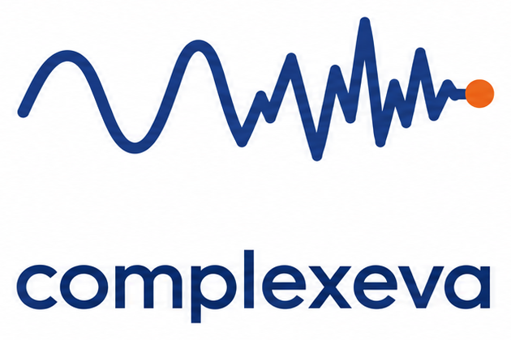
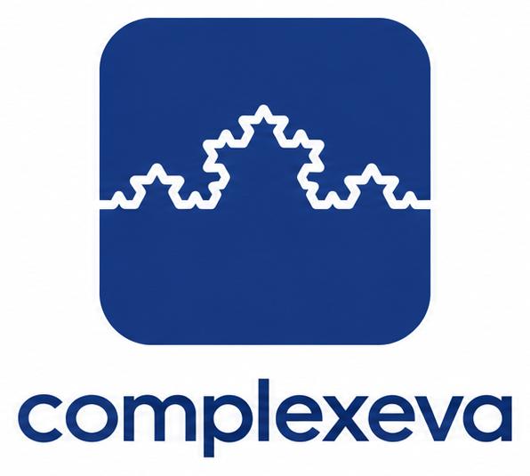
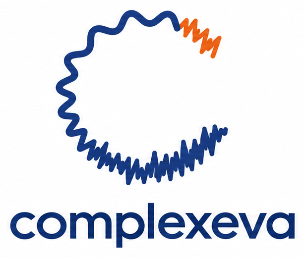

# complexeva

Fast, low-memory complexity measures for 1D time series (EEG, MEG, physiology).

```bash
pip install complexeva  # Python 3.14+
```

```python
import numpy
import complexeva

signal = numpy.random.randn(1000)   # one signal, shape (time,)
complexeva.hfd(signal)              # one float
```

## batches

Pass every signal at once with **time on the last axis**; you get one value per signal, in the shape of the other axes. Each value is identical to calling the measure on that signal alone.

```python
eeg = numpy.random.randn(64, 1000)              # (channels, time)
complexeva.hfd(eeg)                             # shape (64,)

study = numpy.random.randn(20, 64, 1000)        # (subjects, channels, time)
complexeva.sample_entropy(study)                # shape (20, 64)

recording = numpy.random.randn(1000, 64)        # time first? put time last
complexeva.dfa(recording.T)                     # shape (64,)

windows = numpy.lib.stride_tricks.sliding_window_view(signal, 200)[::10]  # (windows, 200), no copy
complexeva.permutation_entropy(windows)         # one value per window
```

Batches work for `hfd`, `dfa`, `permutation_entropy`, `sample_entropy` and numeric `lempel_ziv`; the rest take one signal. A non-finite sample raises an error naming its full index; a constant signal gives NaN in its place. `NUMBA_NUM_THREADS` limits the threads.

## measures

| | measure | input | paper |
|---|---|---|---|
|  | Higuchi fractal dimension<br>`hfd`, `hfd_hilbert` | (…, time) numeric; `hfd_hilbert` 1D | [Higuchi 1988](https://doi.org/10.1016/0167-2789(88)90081-4); [Varley 2020](https://doi.org/10.1371/journal.pone.0223812) |
|  | Lempel–Ziv complexity<br>`lempel_ziv`, `lempel_ziv_hilbert` | (…, time) numeric; Hilbert and binary string 1D | [Kaspar & Schuster 1987](https://doi.org/10.1103/PhysRevA.36.842); [Schartner 2017](https://doi.org/10.1038/srep46421) |
|  | sample entropy<br>`sample_entropy` | (…, time) numeric | [Richman & Moorman 2000](https://doi.org/10.1152/ajpheart.2000.278.6.H2039) |
|  | permutation entropy<br>`permutation_entropy` | (…, time) numeric | [Bandt & Pompe 2002](https://doi.org/10.1103/PhysRevLett.88.174102) |
|  | detrended fluctuation analysis<br>`dfa` | (…, time) numeric | [Peng 1994](https://doi.org/10.1103/PhysRevE.49.1685) |
|  | largest Lyapunov exponent<br>`lyapunov_exponent` | 1D numeric | [Rosenstein 1993](https://doi.org/10.1016/0167-2789(93)90009-P) |
|  | compression complexity<br>`compression_complexity` | 1D array | [Cilibrasi & Vitányi 2005](https://doi.org/10.1109/TIT.2005.844059) |

## speed and memory vs other packages


Batches, against a loop of antropy calls (`NUMBA_NUM_THREADS` sets the thread count):


## validation


## potential icons

| A | B | C |
|---|---|---|
|  |  |  |

## licence

MIT
