# complexeva


Fast, low-memory complexity measures for 1D time series (EEG, MEG, physiology).

```bash
pip install complexeva  # Python 3.14+
```

```python
import numpy
import complexeva

signal = numpy.random.randn(1000)   # one signal, shape (time,)
complexeva.hfd(signal)              # one float
```

## batches

Pass every signal at once with **time on the last axis**; you get one value per signal, in the shape of the other axes. Each value is identical to calling the measure on that signal alone.

```python
eeg = numpy.random.randn(64, 1000)              # (channels, time)
complexeva.hfd(eeg)                             # shape (64,)

study = numpy.random.randn(20, 64, 1000)        # (subjects, channels, time)
complexeva.sample_entropy(study)                # shape (20, 64)

recording = numpy.random.randn(1000, 64)        # time first? put time last
complexeva.dfa(recording.T)                     # shape (64,)

windows = numpy.lib.stride_tricks.sliding_window_view(signal, 200)[::10]  # (windows, 200), no copy
complexeva.permutation_entropy(windows)         # one value per window
```

Batches work for every measure except `lyapunov_exponent`, `compression_complexity`, the `_hilbert` variants and binary-string `lempel_ziv`, which take one signal. `multiscale_entropy` adds a last axis of scales, and `hjorth` returns a (mobility, complexity) pair of arrays. A non-finite sample raises an error naming its full index; a constant signal gives NaN in its place. `NUMBA_NUM_THREADS` limits the threads.

## measures

| | measure | input | paper |
|---|---|---|---|
| 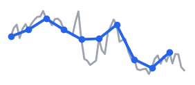 | Higuchi fractal dimension<br>`hfd`, `hfd_hilbert` | [(…,&nbsp;time)](https://don-yin.github.io/complexeva/api.html#complexeva.hfd) | [Higuchi 1988](https://doi.org/10.1016/0167-2789(88)90081-4)<br><br>[Varley 2020](https://doi.org/10.1371/journal.pone.0223812)<br> |
| 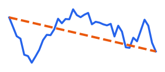 | Katz fractal dimension<br>`katz_fd` | [(…,&nbsp;time)](https://don-yin.github.io/complexeva/api.html#complexeva.katz_fd) | [Katz 1988](https://doi.org/10.1016/0010-4825(88)90041-8)<br> |
| 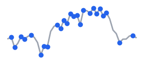 | Petrosian fractal dimension<br>`petrosian_fd` | [(…,&nbsp;time)](https://don-yin.github.io/complexeva/api.html#complexeva.petrosian_fd) | [Petrosian 1995](https://doi.org/10.1109/CBMS.1995.465426)<br> |
| 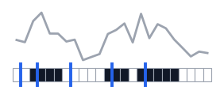 | Lempel–Ziv complexity<br>`lempel_ziv`, `lempel_ziv_hilbert` | [(…,&nbsp;time)](https://don-yin.github.io/complexeva/api.html#complexeva.lempel_ziv) | [Kaspar & Schuster 1987](https://doi.org/10.1103/PhysRevA.36.842)<br><br>[Schartner 2017](https://doi.org/10.1038/srep46421)<br> |
| 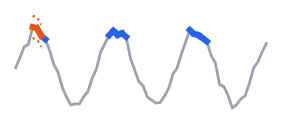 | sample entropy<br>`sample_entropy` | [(…,&nbsp;time)](https://don-yin.github.io/complexeva/api.html#complexeva.sample_entropy) | [Richman & Moorman 2000](https://doi.org/10.1152/ajpheart.2000.278.6.H2039)<br> |
| 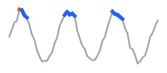 | approximate entropy<br>`approximate_entropy` | [(…,&nbsp;time)](https://don-yin.github.io/complexeva/api.html#complexeva.approximate_entropy) | [Pincus 1991](https://doi.org/10.1073/pnas.88.6.2297)<br> |
| 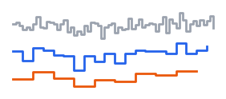 | multiscale entropy<br>`multiscale_entropy` | [(…,&nbsp;time)](https://don-yin.github.io/complexeva/api.html#complexeva.multiscale_entropy) | [Costa 2002](https://doi.org/10.1103/PhysRevLett.89.068102)<br> |
| 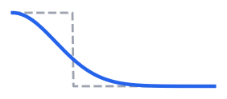 | fuzzy entropy<br>`fuzzy_entropy` | [(…,&nbsp;time)](https://don-yin.github.io/complexeva/api.html#complexeva.fuzzy_entropy) | [Chen 2007](https://doi.org/10.1109/TNSRE.2007.897025)<br> |
|  | permutation entropy<br>`permutation_entropy` | [(…,&nbsp;time)](https://don-yin.github.io/complexeva/api.html#complexeva.permutation_entropy) | [Bandt & Pompe 2002](https://doi.org/10.1103/PhysRevLett.88.174102)<br> |
|  | spectral entropy<br>`spectral_entropy` | [(…,&nbsp;time)](https://don-yin.github.io/complexeva/api.html#complexeva.spectral_entropy) | [Inouye 1991](https://doi.org/10.1016/0013-4694(91)90138-t)<br> |
|  | SVD entropy<br>`svd_entropy` | [(…,&nbsp;time)](https://don-yin.github.io/complexeva/api.html#complexeva.svd_entropy) | [Roberts 1999](https://doi.org/10.1007/BF02513272)<br> |
| 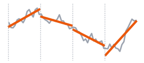 | detrended fluctuation analysis<br>`dfa` | [(…,&nbsp;time)](https://don-yin.github.io/complexeva/api.html#complexeva.dfa) | [Peng 1994](https://doi.org/10.1103/PhysRevE.49.1685)<br> |
|  | correlation dimension<br>`correlation_dimension` | [(…,&nbsp;time)](https://don-yin.github.io/complexeva/api.html#complexeva.correlation_dimension) | [Grassberger & Procaccia 1983](https://doi.org/10.1016/0167-2789(83)90298-1)<br> |
| 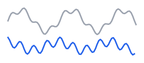 | Hjorth mobility and complexity<br>`hjorth` | [(…,&nbsp;time)](https://don-yin.github.io/complexeva/api.html#complexeva.hjorth) | [Hjorth 1970](https://doi.org/10.1016/0013-4694(70)90143-4)<br> |
| 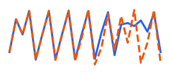 | largest Lyapunov exponent<br>`lyapunov_exponent` | [1D](https://don-yin.github.io/complexeva/api.html#complexeva.lyapunov_exponent) | [Rosenstein 1993](https://doi.org/10.1016/0167-2789(93)90009-P)<br> |
|  | compression complexity<br>`compression_complexity` | [1D](https://don-yin.github.io/complexeva/api.html#complexeva.compression_complexity) | [Cilibrasi & Vitányi 2005](https://doi.org/10.1109/TIT.2005.844059)<br> |

## speed and memory vs other packages

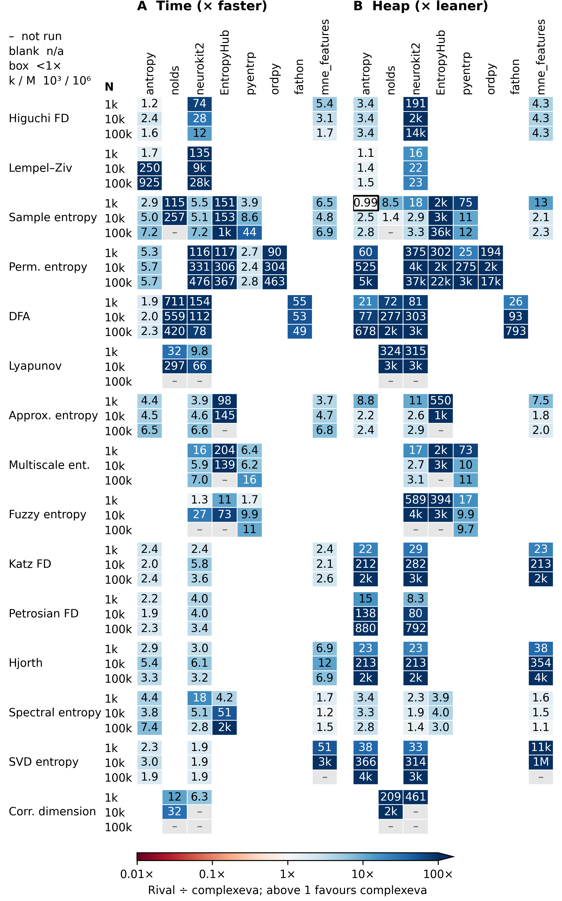

Batches, against a loop of the best other package (`NUMBA_NUM_THREADS` sets the thread count):

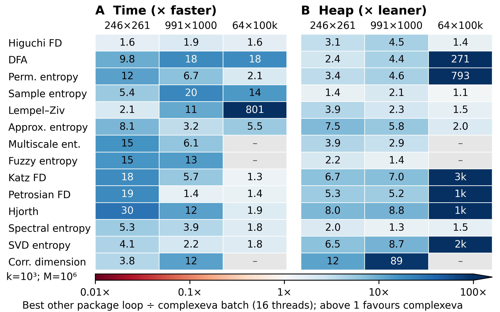

## validation

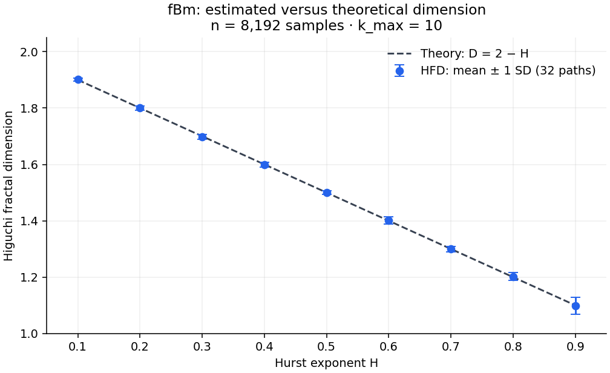

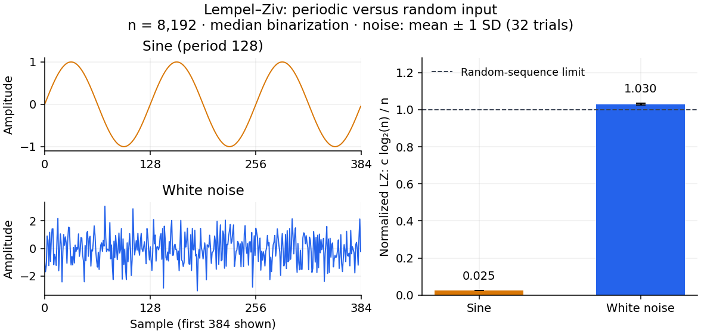

## licence

MIT
